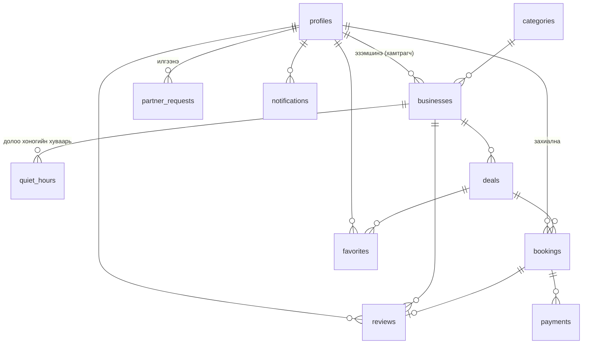

# LastMinute — Нэг боломж. Хоёр хожил.

Улаанбаатарын кино театр, ресторан, салон, спортын талбай, спа, караоке зэрэг байгууллагууд **хаахын өмнөх цаг**, **эрэлт багатай үе**, **цуцлагдсан суудлаа** хямдруулж зардаг платформ. Захиалгат хямдралын үнэ эхлэх цаг ойртох тусам **секунд тутам буурна**.

> SWE334 Интернет программчлал · Бие даалтын төсөл · React + Supabase + QPay

## Шийдэж буй асуудал

- **Байгууллага:** Ресторан үдээс хойш, кино театр өглөө хоосон байдаг. Хаахын өмнө хоол үлддэг. Хоосон суудал бол алдагдсан орлого.
- **Хэрэглэгч:** Хаана, хэзээ хямд болохыг мэдэх нэг газар байдаггүй.
- **Шийдэл:** Байгууллага долоо хоногийн эрэлт багатай, хаах дөхсөн цагаа тохируулна. Хэрэглэгч газрын зураг дээр «яг одоо хямдарч буй» газрыг олж, урьдчилан захиалж QPay-ээр төлнө. Газар дээр нь тасалбарын кодыг шалгана.

## Хямдралын 3 төрөл

| Төрөл | Жишээ |
|---|---|
| 🌙 Хаах дөхсөн | Ресторанд 21:30-аас хойш −40%, буузны газрын өдрийн үлдэгдэл, шөнийн сүүлчийн сеанс |
| ☀️ Эрэлт багатай цаг | Ажлын өдрийн 15:00–17:30, кино театрын өглөөний сеанс, өдрийн фитнес |
| ⏱ Сүүлчийн минут | Цуцлагдсан ширээ, зарагдаагүй VIP суудал |

## Онцлог

- 🌗 Цайвар / бараан / системийн горим (navbar дээрх товч)
- 🛍 Маркетплейс карт: хямдралын хувь, одоогийн/анхны үнэ, хэмнэлт, ухрах тоолуур, үнэлгээ, хэрэглэх хугацаа, байршил ба зай, үлдсэн тоо, нөхцөл, цуцлалтын бодлого, дуртай
- ↕️ Эрэмбэ: удахгүй дуусах, хямдрал %, үнэ (бага/их), хэмнэлт, зай (байршил зөвшөөрөхөд)
- ↩️ Цуцлалт, буцаалт: хямдрал бүр «N цагийн өмнө хүртэл үнэгүй цуцлах» эсвэл «Буцаалтгүй» бодлоготой
- 📱 Гар утсанд доод навигаци, хямдралын хуудсанд доод «Захиалах» самбар

## Хэрэглэгчийн төрлүүд (4)

| Төрөл | Боломж |
|---|---|
| Зочин | Хямдрал, байгууллага, газрын зураг үзэх. Нэр, ангилал, төрөл, дүүрэг, үнэ, огноогоор хайх. «Надад ойр» эрэмбэ |
| Хэрэглэгч | Захиалах, QPay-ээр төлөх, тасалбар, цуцлах, дуртай, үнэлгээ, мэдэгдэл, хамтрагч болох хүсэлт |
| Хамтрагч (байгууллага) | Өөрийн хямдрал CRUD, долоо хоногийн эрэлт багатай цагийн хуваарь, захиалга, **тасалбар шалгах**, байршил/зураг, орлогын статистик |
| Админ | Бүх зүйлийг удирдах, хамтрагчийн хүсэлт зөвшөөрөх/татгалзах, хэрэглэгчийн эрх, платформын статистик |

## Боломжууд

- **Шууд буурах үнэ** — «гал хамхуул» шугам, үнийн муруй график
- **Яг одоо хямдарч байна** — Улаанбаатарын цагаар идэвхтэй хямдралтай газрууд
- **Ачааллын график** — цаг тутмын хүн ихтэй/багатай байдал (Google «Popular times» маягаар), хямдралтай цагийг тэмдэглэнэ
- **Газрын зураг** (Leaflet + OpenStreetMap) — хямдралын хувьтай тэмдэглэгээ, миний байршил, ойрын газар
- **Байгууллагын хуудас** — долоо хоногийн хуваарь, хямдрал, үнэлгээ, «Зам заалгах»
- **QPay төлбөр** — QR, банкны апп, webhook, Realtime-ээр төлөв шинэчлэгдэнэ
- **Тасалбар шалгах** — 8 тэмдэгт код, нэг удаа ашиглана
- **Мэдэгдэл** — төлбөр баталгаажих, шинэ захиалга, хамтрагчийн хүсэлтийн хариу (trigger + Realtime)
- **Хамтрагч болох урсгал** — хүсэлт → админ зөвшөөрөх → байгууллага автоматаар үүсч, эрх нь «business» болно
- **Хуваалцах** товч, дуртай жагсаалт, хэмнэлтийн дүн

## Цуцлалт, буцаалтын урсгал

| Төлөв | Хэн | Юу болох |
|---|---|---|
| Төлөөгүй (`pending`) | Хэрэглэгч | Хэзээ ч цуцална, мөнгө суутгагдаагүй. 15 минутад төлөөгүй бол автоматаар дуусна |
| Төлсөн (`paid`) | Хэрэглэгч | Эхлэхээс `cancel_hours` цагийн өмнө хүртэл «Цуцлах» → `refund_requested`, суудал чөлөөлөгдөнө |
| Буцаалт хүлээгдэж буй | Хамтрагч / админ | Мөнгийг QPay merchant портал эсвэл банкаар буцаагаад «Буцаасан» → `refunded` |
| Ашигласан, хугацаа өнгөрсөн, `cancel_hours = 0` | — | Буцаалтгүй |

Мэдэгдэл алхам бүрт автоматаар очно. QPay-ийн API-аар автоматаар буцаах нь merchant гэрээнээс хамаардаг тул энэ төсөлд гараар баталгаажуулах аргыг сонгосон.

## Технологи

React 18 (Vite), React Router 6, Tailwind CSS 4, Supabase (Auth, PostgreSQL, RLS, Storage, Realtime, Edge Functions), QPay Merchant API v2 (sandbox), Leaflet, Recharts, Vercel.

## Архитектур

```
 Browser (React, Vercel)
   │  anon key + хэрэглэгчийн JWT
   ├──► PostgREST ──► PostgreSQL (11 хүснэгт, RLS бүгдэд)
   ├──► Realtime  ◄── bookings, notifications
   └──► Edge Function: qpay-create-invoice ──► QPay /invoice
        Банкны апп QR уншуулж төлнө ─────────────────┐
        Edge Function: qpay-webhook ◄── QPay callback ┘
            ├─► QPay /payment/check-ээр дахин шалгана
            └─► confirm_payment() → bookings.paid
                    └─► trigger → notifications (хэрэглэгч + хамтрагч)
```

## ERD (11 хүснэгт)



- **1:N** — categories→businesses, businesses→quiet_hours, businesses→deals, bookings→payments
- **N:M** — `favorites` (profiles ↔ deals), `bookings` (profiles ↔ deals)

## RLS товч

| Хүснэгт | Унших | Бичих |
|---|---|---|
| categories | Хэн ч | Админ |
| businesses | Идэвхтэйг хэн ч | Үүсгэх/устгах админ, засах эзэн/админ |
| quiet_hours, deals | Хэн ч (идэвхтэй) | Тухайн байгууллагын эзэн эсвэл админ |
| bookings | Өөрийнхөө, эсвэл өөрийн байгууллагынх | Зөвхөн `create_pending_booking()` |
| payments | Өөрийнхөө (callback_token баганагүй) | Зөвхөн service_role |
| profiles | Өөрийнхөө, админ, хамтрагч өөрийн үйлчлүүлэгчийг | Өөрийнхөө (role-ийг trigger хамгаална) |
| partner_requests | Өөрийнхөө, админ | Өөрөө `pending` төлөвтэй; шийдвэр RPC-ээр |
| notifications | Өөрийнхөө | Зөвхөн `is_read` багана; үүсгэх нь trigger |
| storage `images` | Хэн ч | Админ, хамтрагч (2MB, jpeg/png/webp) |

## Суулгах

**Шаардлага:** Node.js 18+, Supabase бүртгэл, [Supabase CLI](https://supabase.com/docs/guides/cli).

```bash
npm install
cp .env.example .env     # VITE_SUPABASE_URL, VITE_SUPABASE_ANON_KEY
```

1. **Өгөгдлийн сан:** Supabase → SQL Editor-т дарааллаар:
   `supabase/migrations/20261105000000_init.sql` → `supabase/seed.sql` (6 ангилал, 21 бодит газар, 219 эрэлт багатай цаг, 27 жишээ хямдрал)
2. **Edge Functions:**
   ```bash
   supabase link --project-ref <ref>
   cp supabase/functions/.env.example supabase/functions/.env
   supabase secrets set --env-file supabase/functions/.env
   supabase functions deploy --no-verify-jwt
   ```
3. **Auth:** Authentication → URL Configuration → Site URL `http://localhost:5173`, Redirect URLs-д `http://localhost:5173/**`
4. `npm run dev` → http://localhost:5173
5. **Админ, хамтрагч үүсгэх:** сайтад 2 бүртгэл үүсгээд SQL Editor-т (`seed.sql`-ийн төгсгөлд жишээ бий):
   ```sql
   update public.profiles set role = 'admin'
    where id = (select id from auth.users where email = 'admin@...');
   ```
   Хамтрагчийг хоёр аргаар: (a) хэрэглэгчээр «Хамтрагч болох» хүсэлт илгээгээд админаар зөвшөөрөх, (b) seed-ийн жишээ SQL-ээр «Dodo Pizza»-гийн эзэн болгох.

## Төлбөр турших

| `QPAY_MODE` | Ажиллагаа |
|---|---|
| `sandbox` | QPay sandbox (`merchant-sandbox.qpay.mn`, `TEST_MERCHANT / 123456`) руу жинхэнэ нэхэмжлэл үүсгэнэ |
| `mock` | QPay-д хандахгүй. «Төлсөн мэт турших» товч QPay-тэй адилаар webhook URL-ийг дуудна |

Edge Function secret-ийн `QPAY_MODE` болон frontend-ийн `VITE_QPAY_MODE` ижил байх ёстой.

**Бүтэн урсгал:** Хэрэглэгч захиалж төлнө → тасалбар, мэдэгдэл ирнэ → хамтрагч «Шинэ захиалга» мэдэгдэл авна → хамтрагч «Тасалбар шалгах»-д кодыг оруулж баталгаажуулна → тасалбар «Ашигласан» болно.

## Vercel

1. GitHub-д push → Vercel → New Project (Vite)
2. Environment Variables: `VITE_SUPABASE_URL`, `VITE_SUPABASE_ANON_KEY`, `VITE_QPAY_MODE`
3. Domains-д өөрийн домэйн нэмж DNS тохируулна
4. Supabase Auth URL Configuration-д домэйнээ нэмнэ
5. `vercel.json` SPA-ийн замуудыг `index.html` руу чиглүүлнэ

## Аюулгүй байдал

- Frontend зөвхөн **anon** түлхүүртэй. `service_role` зөвхөн Edge Function-д.
- Төлөх үнийг сервер тооцно. Захиалгад мөр түгжээ (`for update`) ашиглана.
- Webhook: таамаглах боломжгүй token + QPay API-аар давхар шалгана.
- Хамтрагч зөвхөн **өөрийн** байгууллагын өгөгдөлд хүрнэ (`can_manage_business()`).
- Цаг хугацааны тооцоог `Asia/Ulaanbaatar` бүсээр хийнэ.

## Хавтасны бүтэц

```
src/
  components/          DealCard, PriceFuse, BusyChart, PlacesMap, LocationPicker, Skyline, NotificationBell …
  components/manage/   Админ, хамтрагчид хуваалцсан: StatsDashboard, DealsManager, BookingsManager, QuietHoursManager, CheckIn
  lib/                 supabase, pricing, ub (цагийн бүс, хямдралын төрөл), geo, validation, format, storage
  pages/               Home, Deals, DealDetail, BusinessPage, MapPage, Checkout
  pages/auth|account/  Нэвтрэх, бүртгэл, миний захиалга, дуртай, профайл
  pages/partner/       PartnerApply, PartnerLayout, PartnerPages
  pages/admin/         Dashboard, AdminRequests, AdminDeals, AdminBusinesses, AdminCategories, AdminBookings, AdminUsers
supabase/
  migrations/          Хүснэгт, RLS, функц, trigger, Storage
  seed.sql             Жишээ өгөгдөл
  functions/           qpay-create-invoice, qpay-webhook, qpay-check, qpay-mock-pay
```

## Туршилтын эрх (хамгаалалтад бөглөнө)

| Эрх | Имэйл | Нууц үг |
|---|---|---|
| Админ | | |
| Хамтрагч (Dodo Pizza) | | |
| Хэрэглэгч | | |

## Жишээ өгөгдлийн тухай

Seed дэх 21 байгууллага бодитоор байдаг (нэр, хаяг нь нийтэд ил эх сурвалжаас). Plus code-той 5 газрын координат тодорхой, бусдынх нь хаягаар тооцсон ойролцоо байршил тул хамтрагч «Байгууллагын мэдээлэл» хэсгээс газрын зураг дээр дарж засна. Харин **хямдрал, үнэ, ачаалал, эрэлт багатай цагийн хуваарь бүгд жишээ** бөгөөд эдгээр байгууллага LastMinute-тэй хамтран ажиллаагүй. Иймд:

- `businesses.is_demo = true` бөгөөд байгууллага, хямдралын хуудсанд анхааруулга харагдана.
- Нүүр хуудасны дээд хэсэгт туршилтын хувилбарын мэдэгдэл гарна (`VITE_DEMO_NOTICE=false` болгож унтраана).
- Бодит хамтрагч нэгдэхэд «Хамтрагч болох» урсгалаар өөрсдийн мэдээлэл, хямдралаа оруулна.
